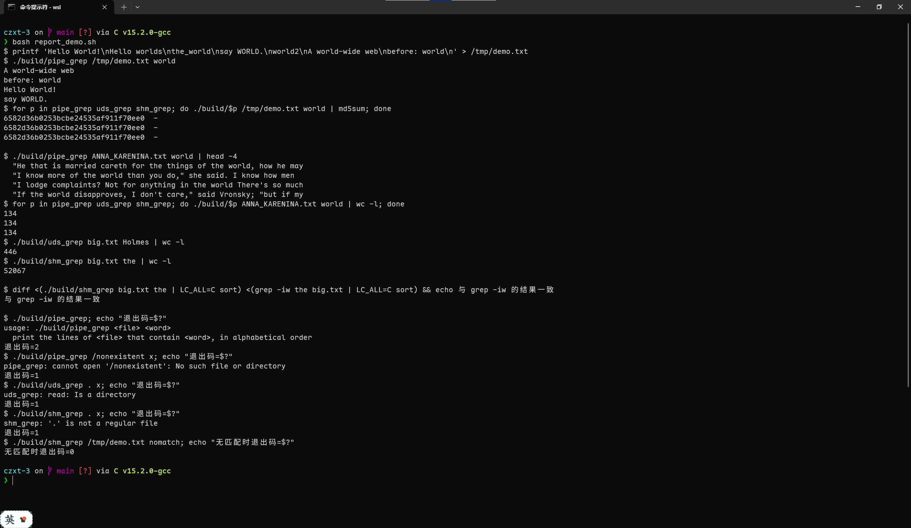
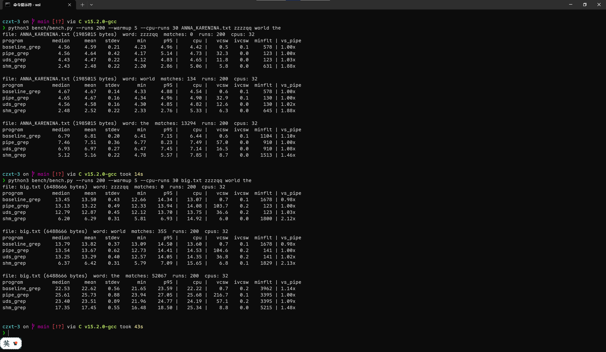

# Lab03 实验报告：IPC 与 map-reduce

**姓名**：贾筱雨　**学号**：24281099

## 本报告与作业要求的对应关系

| Lab03.md 中的要求 | 对应章节 |
|---|---|
| Time the execution of your three programs, and analyze what contributes to the performance difference | 第 4 章 |
| Your design of the program | 第 2 章 |
| Snapshots of experimental results (statistics) with analysis | 第 3 章（正确性与健壮性快照）、第 4 章（性能数据与分析） |
| Problems encountered and your solution | 第 5 章 |
| Summarize the different IPC methods provided by Linux, and describe when to use which | 第 6 章 |
| Write a short paragraph about map-reduce | 第 7 章 |
| Write a short paragraph about Hadoop, and your understanding why it is popular and important in industry | 第 8 章 |
| Reference materials | 第 9 章 |
| Your suggestions and comments | 第 10 章 |

## 摘要

- **实现**：用管道、Unix 域套接字和 POSIX 共享内存三种 IPC 实现了同一个任务（输出包含给定单词的行，按字母序）；共享内存版的子进程用 4 个 POSIX 线程做 map、主线程做唯一的 reduce。`make test` 的 31 项测试全部通过，ASan、UBSan、LeakSanitizer、TSan 和 valgrind 都没有报告，故障注入（`kill -9`、Ctrl-C、内存不足）下都不会挂起。
- **性能**：在两个样例文件上，`shm_grep` 比 `pipe_grep` 快 1.44–2.10 倍；`pipe_grep` 和 `uds_grep` 与单进程基线几乎一样快，`uds_grep` 比 `pipe_grep` 略快 2%–8%。
- **原因**：差异主要来自并行。4 个 mapper 把单线程 11.75 ms 的匹配缩短到 3.36 ms（`big.txt` + `world`），而共享内存本身的“零拷贝”传输并不比套接字快；只用 1 个 mapper 或只给 1 个 CPU 时，共享内存版反而更慢。串行部分（把文件读进共享内存、最后的排序输出）限制了加速比，结果很多时排序占总耗时的 42%–76%。管道与套接字的差别来自缓冲区大小（64 KiB 对 208 KiB），把管道容量调到 1 MiB 后差距消失。
- **遇到的问题**：管道死锁、数据块与分段的行边界、共享内存解除映射后 `SIGCHLD` 处理函数仍被调用（ASan + LeakSanitizer 发现的缺陷）、`rusage` 对短命线程少计 CPU 时间（改用 perf 并交叉验证）等，见第 5 章。

## 1. 概述

### 1.1 任务

给定一个文本文件和一个单词，输出文件中包含该单词的行，按字母序排列。程序运行时父进程创建一个子进程，两者分工固定：

- 父进程可以打开并读取文件、把内容传给子进程，但不能检查单词；最后由**父进程**按字母序输出结果。
- 子进程不能打开文件，只能通过 IPC 拿到内容，负责检查单词。

同一个任务用三种方式各实现一遍：

| 子项目 | 程序 | 父子进程之间的 IPC | 子进程内部 |
|---|---|---|---|
| 1 | `pipe_grep` | 匿名管道 | 单线程 |
| 2 | `uds_grep` | Unix 域套接字 | 单线程 |
| 3 | `shm_grep` | POSIX 共享内存 + 信号量 | 4 个 mapper 线程 + 主线程作为唯一的 reducer（map-reduce） |

map-reduce 只用在第 3 个子项目里，用 POSIX 线程实现，没有使用 Hadoop。

### 1.2 提交内容

| 内容 | 位置 |
|---|---|
| 代码与 Makefile | `Makefile`、`common.c`、`common.h`、`pipe_grep.c`、`uds_grep.c`、`shm_grep.c` |
| 测试脚本 | `tests/run_tests.py`（`make test`） |
| 计时脚本 | `bench/bench.py`（端到端计时）、`bench/phases.py`（耗时分解）、`bench/baseline.c`（单进程基线） |
| README | `README.md`：设计概述、编译与使用方法 |
| 本报告 | `REPORT.md` |

### 1.3 实验环境

| 项目 | 内容 |
|---|---|
| CPU | Intel Core i9-14900HX，虚拟机内可见 32 个逻辑 CPU（L2 共 32 MiB，L3 36 MiB） |
| 内存 | 15.8 GB |
| 运行环境 | WSL2（Hyper-V 虚拟机），Ubuntu 26.04.1 LTS，Linux 6.18.54.1-microsoft-standard-WSL2 |
| 编译器与库 | gcc 15.2.0（`-std=gnu11 -O2`），glibc 2.43 |
| 脚本 | Python 3.14.4，只用标准库 |

## 2. 程序设计

### 2.1 总体结构

三个程序共用同一套匹配、排序和读写代码（`common.c`），区别只在父子进程之间传递数据的方式。题目的各项约束在代码里的落实如下：

| 题目约束 | 实现方式 |
|---|---|
| 父进程创建子进程 | 三个程序都用 `fork` |
| 父进程能读文件，但不能检查单词 | 父进程把文件内容当作不透明的字节流搬运（`send_file`，或直接 `read` 进共享内存），从不调用匹配函数 |
| 子进程不能打开文件，但能检查单词 | `fork` 之后子进程第一件事是关闭继承来的文件描述符；数据只能从 IPC 通道读取；匹配函数只在子进程里被调用 |
| 由父进程而不是子进程按字母序输出 | 子进程只返回匹配的行；排序和输出（`sort_and_print`）在父进程里 |
| 不得建立索引，能处理任意文本文件 | 每次运行都完整扫描一遍文件，文件路径和单词由命令行传入 |
| 共享内存版：子进程 4 个线程作 mapper，主线程作唯一 reducer，用 POSIX 线程 | `pthread_create` 创建 4 个 mapper，主线程 `pthread_join` 后汇总 |

`common.c` 中的函数按调用方分成两组：

| 调用方 | 函数 | 作用 |
|---|---|---|
| 父进程 | `send_file` | 以 64 KiB 为单位读文件并写入通道 |
| 父进程 | `read_to_eof` | 从通道读取全部结果，缓冲区按需倍增 |
| 父进程 | `wait_child` | `waitpid` 回收子进程；非 0 退出或被信号杀死都报错 |
| 父进程 | `sort_and_print` | 把结果按 `\n` 切成行，`qsort` 排序，一次 `write` 输出 |
| 子进程 | `child_filter_stream` | 管道和套接字版本的子进程主体 |
| 子进程 | `grep_lines` | 对一段由完整的行组成的数据做匹配 |
| 共用 | `die`、`die_errno`、`xmalloc`、`buf_*`、`read_retry`、`write_all` | 出错退出、内存、可增长缓冲区、处理 `EINTR` 和短写的读写 |

### 2.2 题目没有定义的两个细节：什么叫“包含单词”，什么叫“字母序”

**匹配规则**：不区分大小写的整词匹配，等价于 `grep -iw`。单词字符是字母、数字和下划线，其余字符（空格、标点、`-`、`'`、`\r`、非 ASCII 字节等）都是分隔符。因此题目中的 `Hello World!` 会被输出，`Hello worlds` 不会；`A world-wide web` 会被输出，`the_world`、`world2` 不会。单词参数本身含标点（如 `don't`）时按字面匹配，只检查匹配处两端相邻的字符。

**排序规则**：逐字节比较，ASCII 字母不区分大小写（`Apple` 与 `apple` 相邻）；一行是另一行的前缀时，短的在前；两行只有大小写不同时，再按原始字节序决定先后（大写在前）。最后这条使输出顺序是确定的，不依赖 mapper 的执行顺序。

另外约定：输出的每一行都以 `\n` 结尾（输入最后一行没有换行符时也会补上），重复的行都保留，`\r` 原样保留，大小写折叠只针对 ASCII 字母。

### 2.3 `pipe_grep`：匿名管道

```
父进程                                          子进程
read(file_fd, 64KB)
write(to_child[1])    ---- file content ---->   read(to_child[0])，边读边匹配
close(to_child[1])    ------- EOF ------->      read 返回 0，匹配最后一段
read(from_child[0])   <--- matched lines ---    write(from_child[1])，一次写回
waitpid；排序；输出
```

1. 父进程打开文件，创建两条管道（`to_child`：父到子，`from_child`：子到父），然后 `fork`。
2. 双方各自关闭用不到的那一端。一条管道的所有写端都关闭后，读端才会读到 EOF，所以子进程要关掉它继承来的 `to_child` 写端，父进程发完文件后也要关闭自己的写端。
3. 父进程循环 `read`（文件）、`write`（`to_child`），每次 64 KiB。
4. 子进程分块读入（`child_filter_stream`）。缓冲区的前 `have` 个字节是上一轮留下的、还不完整的半行；每次读入新数据后，只需在新数据里用 `memrchr` 找最后一个 `\n`，把此前的部分交给 `grep_lines`，剩下的半行用 `memmove` 挪到缓冲区开头。一行特别长时缓冲区倍增。EOF 之后再处理最后一行（可能没有 `\n`）。
5. 匹配的行先攒在子进程的内存里，读到 EOF 后一次性写入 `from_child`。回写放在读完之后：父进程在发完文件之前不读取结果，如果子进程边读边回写，两个方向的管道写满后双方会互相等待（死锁）。
6. 父进程读到 EOF 后 `waitpid`，然后排序输出。

父进程在与子进程通信期间忽略 `SIGPIPE`：子进程提前退出时，`write` 返回 `EPIPE`，父进程报出明确的错误，而不是被信号悄悄杀死；排序输出前恢复默认处理，因此 `./build/pipe_grep ... | head` 的行为与普通命令一致。

### 2.4 `uds_grep`：Unix 域套接字

```
父进程                                          子进程
read(file_fd, 64KB)
write(sv[0])          ---- file content ---->   read(sv[1])，边读边匹配
shutdown(sv[0], SHUT_WR) ----- EOF -------->    read 返回 0，匹配最后一段
read(sv[0])           <--- matched lines ---    write(sv[1])，一次写回
waitpid；排序；输出
```

父子进程由 `fork` 关联，所以用 `socketpair(AF_UNIX, SOCK_STREAM, 0, sv)` 直接得到一对已连接的匿名套接字，不需要路径名，也不需要 `bind`/`listen`/`accept`。与管道版本的区别：

- 一条套接字就是一条双向通道：父进程用 `sv[0]`，子进程用 `sv[1]`，输入和结果走同一条连接，不需要两条。
- 管道靠“关闭写端”表示 EOF，而套接字的两个方向共用一个文件描述符，不能关闭。父进程发完文件后调用 `shutdown(sv[0], SHUT_WR)` 半关闭：子进程读到 EOF，而父进程仍能从同一个套接字读回结果。

子进程复用 `child_filter_stream`（输入输出传同一个描述符），其余流程与 `pipe_grep` 相同，所以两个程序之间的差别只来自 IPC 机制本身。

### 2.5 `shm_grep`：共享内存与 map-reduce

**共享内存布局**：一整块，由父进程创建，`fork` 后子进程继承映射。

```
+-------------------+------------------------+--------------------------+
| control block     | input area             | result area              |
| 4096 B            | N bytes                | N+1 bytes                |
+-------------------+------------------------+--------------------------+
```

- 控制块（`struct shm_ctl`）：两个进程间共享的 POSIX 信号量 `input_ready`、`result_ready`，以及 `input_len`、`result_len`。
- 输入区：父进程把文件内容 `read` 到这里，mapper 只读。
- 结果区：reducer 把匹配的行写到这里，父进程直接从这里排序输出。

`N` 是文件大小（`fstat`）。结果是输入行的子集，每行末尾补一个 `\n`，总长度最多比输入多 1 字节（最后一行没有换行符时），所以结果区 `N+1` 字节足够。

**创建过程**：`shm_open("/lab03_shm_<pid>", O_CREAT|O_EXCL)`，随即 `shm_unlink`，再 `ftruncate`、`mmap(MAP_SHARED)`，最后 `fork`。子进程通过继承得到映射，名字不再需要，所以创建后立即删除；之后即使进程被信号杀死，内核也会在两个进程都退出后回收这块内存，不会在 `/dev/shm` 里残留对象。

**同步**：两个信号量初值都是 0（`sem_init` 的 `pshared` 参数为 1）。

- `input_ready`：父到子，文件内容已经读进输入区（长度记在 `input_len`）。
- `result_ready`：子到父，结果已经写进结果区（长度记在 `result_len`）。

`sem_post` 与对应的 `sem_wait` 之间建立了内存同步关系，所以 `input_len`、`result_len` 和输入输出区的内容不需要额外的原子操作。

**流程**：

```
父进程                                          子进程
fstat；shm_open、mmap；fork
read(file_fd) 直接读进输入区
sem_post(input_ready)   ----------------->      sem_wait(input_ready)
                                                把输入区切成 4 段，创建 4 个 mapper 线程
                                                  mapper 0..3：各扫一段，匹配的行放进私有缓冲区   (map)
                                                主线程依次 pthread_join，把 4 份结果拼进结果区    (reduce)
sem_wait(result_ready)  <-----------------      sem_post(result_ready)
waitpid；直接从结果区排序并输出
```

- **map**（`map_thread`）：输入区按字节数四等分，分界点为 `n/4*i`，然后向后对齐到下一个行首（`align_to_line`），所以每个 mapper 拿到的都是完整的行，每行恰好属于一个 mapper。输入区只读，每个 mapper 的输出缓冲区（`struct mapper` 里的 `struct buf out`）是私有的，线程之间没有共享的可写数据，不需要加锁。
- **reduce**（`child_main` 中标注 reduce 的循环）：子进程的主线程是唯一的 reducer，按编号依次 `pthread_join` 各 mapper，把它们的结果拼接进结果区，最后设置 `result_len` 并 `sem_post(result_ready)`。这与 MapReduce 论文中的分布式 grep 相同：map 函数输出匹配的行，reduce 函数是恒等函数，只负责汇总。因为各段按顺序拼接，结果保持文件中的原有顺序。
- 排序放在父进程，与另外两个程序一致。

**异常处理**：

- 子进程崩溃或被杀死时，父进程的 `SIGCHLD` 处理函数会 `sem_post(result_ready)`，父进程被唤醒后 `waitpid` 并报告子进程的状态，不会永远阻塞在信号量上。回收子进程后立即把 `SIGCHLD` 恢复为默认处理，因为此后共享内存会被解除映射，处理函数不应再访问它。
- 父进程先退出时（例如读文件出错），子进程通过 `prctl(PR_SET_PDEATHSIG, SIGKILL)` 随之终止，不会遗留在 `sem_wait` 上。

### 2.6 错误处理汇总

| 情形 | 处理 | 表现 |
|---|---|---|
| 命令行参数不对（缺少参数、单词为空） | 打印用法 | 退出码 2 |
| 文件打不开、读写出错、内存不足 | `die_errno` 打印“程序名: 原因” | 退出码 1 |
| 子进程异常（被信号杀死或非 0 退出） | `wait_child` 报告 | 退出码 1，如 `child process killed by signal 9` |
| 子进程提前退出，父进程还在写（管道、套接字） | 忽略 `SIGPIPE`，`write` 返回 `EPIPE` | 退出码 1，`write: Broken pipe` |
| 父进程先退出 | 管道、套接字：子进程读到 EOF 后结束；共享内存：`PR_SET_PDEATHSIG` | 子进程不会遗留 |
| `shm_grep` 的输入不是普通文件 | 报错 | 退出码 1，需要事先知道文件大小 |
| `/dev/shm` 容量不足 | 父进程 `read` 返回 `EFAULT`，或子进程收到 `SIGBUS` | 退出码 1，不会挂起 |
| 输出所在的管道被读端提前关闭（例如接在 `head` 后面） | 输出前恢复 `SIGPIPE` 的默认处理 | 与普通命令一致 |

### 2.7 设计取舍

| 决策 | 理由 | 代价 |
|---|---|---|
| 三个程序共用 `common.c` | 匹配、排序、读写是同一份代码，性能差异只来自 IPC 和并行度 | 无 |
| 排序放在父进程 | 题目要求 | 排序是三个程序共有的串行开销 |
| 管道、套接字版的子进程读完再整体回写结果 | 避免双方互相等待的死锁 | 子进程要缓存全部结果；结果传输不与匹配重叠 |
| 共享内存版一次性把整个文件读入共享内存，读完再启动 map | 实现简单，同步只需两个信号量 | 读文件与 map 不重叠；需要约“文件大小 + 结果大小”的共享内存 |
| 输入均分成 4 段，边界对齐到行首 | 分段无需扫描，mapper 之间无锁 | 匹配分布不均匀时负载不均（`big.txt` 上最长的 mapper 比最短的多 8%–9%，匹配行很多的 `the` 多 35%，见 4.3 节） |
| 用 `socketpair` 而非命名套接字 | 父子进程由 `fork` 关联，不需要路径名和 `bind`/`listen`/`accept` | 不能用于无亲缘关系的进程 |
| `shm_open` 后立即 `shm_unlink` | 异常退出也不会在 `/dev/shm` 里留下对象 | 其他进程无法再按名字打开它（本程序不需要） |

## 3. 正确性与健壮性验证（实验结果快照）

本章的输出都是在第 1.3 节所述环境中实际运行得到的原始记录，没有改动。

### 3.1 构建与功能演示

`make` 使用 `-Wall -Wextra`，没有任何警告，可执行文件和 `.o` 文件都生成在 `build/` 下：


终端演示：



从中可以看到：

- 三个程序对同一输入的输出完全相同（三个 `md5sum` 一致）。
- 题目中的例子：`Hello World!` 和 `say WORLD.` 被输出，`Hello worlds` 没有；`world2`、`the_world` 里没有独立的单词 `world`，同样没有输出；`A world-wide web` 里的 `world` 被连字符隔开，算作整词。输出按字母序排列且不区分大小写：`A world-wide web` < `before: world` < `Hello World!` < `say WORLD.`。
- 样例文件上的匹配行数：`ANNA_KARENINA.txt` 中 `world` 为 134 行，`big.txt` 中 `Holmes` 为 446 行、`the` 为 52,067 行；与 `grep -iw` 的结果（按行集合比较）一致。
- 参数错误、文件不存在、参数是目录时，程序给出明确的错误信息并以非 0 退出码结束；没有匹配的行不算错误，退出码为 0。`shm_grep` 需要事先知道文件大小，所以拒绝目录。

### 3.2 自动化测试

`make test` 运行 `tests/run_tests.py`：把三个程序的输出与 Python 参考实现逐字节比较，参考实现本身也与 `grep -iw` 对照。覆盖的内容有：题目中的例子、空文件、最后一行没有换行符、CRLF、含 NUL 字节和 UTF-8 的内容、3 MB 的超长行、30 万行全部命中（结果远大于管道和套接字的缓冲区）、200 个随机小文件（覆盖 `shm_grep` 的分段边界）、两个样例文件各 5 个单词、错误处理，以及 `/dev/shm` 中没有残留的共享内存对象。运行结果：


### 3.3 变异测试：测试集能否发现缺陷

为了检验测试集本身是否可靠，在源码副本里故意植入三个缺陷，再运行同一套测试：

| 变异 | 植入的缺陷 | 测试结果 | 失败的测试涉及的程序 |
|---|---|---|---|
| `m1_no_right_boundary` | 去掉整词匹配的右边界检查 (worlds 也会匹配 world) | 21 项通过，10 项失败 | `pipe_grep`、`shm_grep`、`uds_grep` |
| `m2_no_align` | mapper 的分段边界不再对齐到行首 | 21 项通过，10 项失败 | `shm_grep` |
| `m3_drop_carry` | 数据块末尾的半行不再保留到下一块 | 22 项通过，9 项失败 | `pipe_grep`、`uds_grep` |

三类缺陷都被发现，而且受影响的程序与缺陷所在的位置一一对应：`m2` 只影响 `shm_grep`，`m3` 只影响 `pipe_grep` 和 `uds_grep`，`m1` 在公共的匹配函数里，所以三个程序都受影响。`m3` 的失败项数在不同次运行之间有小幅波动（两次运行分别是 8 项和 9 项），因为它只在 `read` 返回的数据块边界恰好落在匹配行中间时才出错，而块边界取决于调度。

### 3.4 内存与并发检查

```
[ASan+UBSan+LSan] 全套测试 (tests/run_tests.py) 的最后两行:

31 项通过, 0 项失败
[valgrind memcheck] pipe_grep  退出码=0  输出行数=134  valgrind 报告行数=0
[valgrind memcheck] uds_grep   退出码=0  输出行数=134  valgrind 报告行数=0
[valgrind memcheck] shm_grep   退出码=0  输出行数=134  valgrind 报告行数=0
[TSan] shm_grep big.txt the     数据竞争警告数=0
[TSan] shm_grep big.txt world   数据竞争警告数=0
[TSan] shm_grep big.txt Holmes  数据竞争警告数=0
[TSan 有效性检查] 让 4 个 mapper 故意共用一个输出缓冲区, 替换点数=2
[TSan] 故意引入数据竞争的版本: 警告数=13 (应大于 0)
```

- **ASan + UBSan + LeakSanitizer**：用 `-fsanitize=address,undefined` 重新编译三个程序，运行全套 31 项测试，全部通过，没有任何报告。
- **valgrind memcheck**（`--trace-children=yes`，所以子进程也被检查）：三个程序都是 0 个错误、0 处泄漏。
- **ThreadSanitizer**：`shm_grep` 在 `big.txt` 上对三个单词运行，没有数据竞争警告。为了确认 TSan 在这个环境里确实有效，故意让 4 个 mapper 共用一个输出缓冲区，这时它报出了 13 条警告。因此“零警告”是有意义的：各 mapper 的输出缓冲区是私有的，输入区只读，线程之间没有共享的可写数据。

### 3.5 map-reduce 的线程结构

在 `shm_grep` 扫描一个 1 GB 的文件期间，轮询子进程的 `/proc/<pid>/status`，记录线程数：

```
[线程数] shm_grep 扫描 1GB 文件期间, 轮询子进程的 /proc/<pid>/status
  子进程线程数峰值 = 5 (主线程 + 4 个 mapper), 采样 175298 次, 退出码 0
```

线程数峰值为 5，即主线程（reducer）加 4 个 mapper，与设计一致。各 mapper 的负载大体均衡：在 `big.txt` 上，4 个 mapper 的墙钟耗时（最短–最长）对 `zzzzqq` 是 2.90–3.13 ms，对 `world` 是 3.00–3.26 ms，对匹配行很多的 `the` 差别稍大，是 2.23–3.02 ms（见 4.3 节）。

### 3.6 故障注入

下面的检查都在运行中实际注入故障（`kill -9`、Ctrl-C、限制内存、缩小 `/dev/shm`），确认程序要么给出明确的错误，要么随之退出，不会挂起，也不会留下孤儿进程或共享内存对象。

```
[Ctrl-C] 对整个进程组发送 SIGINT (等价于终端里按 Ctrl-C)
  pipe_grep 退出码=-2 (-2 表示被 SIGINT 终止)  残留子进程=[]  /dev/shm 残留=[]
  uds_grep  退出码=-2 (-2 表示被 SIGINT 终止)  残留子进程=[]  /dev/shm 残留=[]
  shm_grep  退出码=-2 (-2 表示被 SIGINT 终止)  残留子进程=[]  /dev/shm 残留=[]
[故障注入] 子进程被 kill -9
  pipe_grep 父进程退出码=1  stderr: pipe_grep: write: Broken pipe
  uds_grep  父进程退出码=1  stderr: uds_grep: write: Broken pipe
  shm_grep  父进程退出码=1  用时 0.31s  stderr: shm_grep: child process killed by signal 9
[故障注入] 父进程被 kill -9, 子进程是否随之退出
  pipe_grep 子进程 106726: 已退出
  uds_grep  子进程 106734: 已退出
  shm_grep  子进程 106736: 已退出
[故障注入] 限制虚拟内存 (RLIMIT_AS), 使子进程的 pthread_create 失败
  RLIMIT_AS=40000 KB: 退出码=1  用时 0.02s  stderr: shm_grep: pthread_create: Resource temporarily unavailable | shm_grep: child process exited with status 1
  RLIMIT_AS=60000 KB: 退出码=0  用时 0.03s  stderr: 
```

`/dev/shm` 容量不足时的表现（用 `unshare -rm` 在私有挂载命名空间里把一个小的 tmpfs 挂到 `/dev/shm` 上）：

```
big.txt 为 6488666 字节, 单词 the 的结果约 3.8 MB
/dev/shm 容量 4m: 退出码=1 stdout字节=0 stderr=shm_grep: read: Bad address
/dev/shm 容量 9m: 退出码=1 stdout字节=0 stderr=shm_grep: child process killed by signal 7
/dev/shm 容量 16m: 退出码=0 stdout字节=3841904 stderr=
```

结论：

- **Ctrl-C**：对整个进程组发送 `SIGINT`，三个程序都被终止（退出码 -2 表示被 `SIGINT` 杀死），没有残留的子进程，`/dev/shm` 里也没有残留对象。
- **子进程被杀**：管道版、套接字版的父进程在写数据时得到 `EPIPE`，报 `write: Broken pipe`；共享内存版的父进程被 `SIGCHLD` 处理函数唤醒，报 `child process killed by signal 9`，不会永远等在信号量上。
- **父进程被杀**：三个版本的子进程都随之退出。管道版和套接字版是因为读到了 EOF，共享内存版靠的是 `PR_SET_PDEATHSIG`。
- **子进程创建不出线程**（虚拟内存上限 40,000 KB）：`pthread_create` 失败，子进程以状态 1 退出，父进程立即报告，耗时 0.02 s，没有挂起；放宽到 60,000 KB 后正常。
- **`/dev/shm` 容量不足**：容量 4 MB 时输入区放不下，父进程的 `read` 写共享映射失败，返回 `EFAULT`（`Bad address`）；容量 9 MB 时输入放得下但结果区放不下，子进程写结果时收到 `SIGBUS`（信号 7），父进程报告子进程被信号 7 杀死；容量 16 MB 时正常。两种失败都是退出码 1 的干净退出。

## 4. 性能：计时与差异分析

### 4.1 测量方法

**被测程序。** 交付的三个程序（`-O2`），外加一个单进程基线 `baseline_grep`（`bench/baseline.c`）：它在同一个进程里读文件、匹配、排序、输出，使用与三个程序相同的 `common.c`，用来衡量 IPC 和并行各自带来的开销与收益。没有用 GNU grep 做基线：当标准输出是 `/dev/null` 时，它在第一个匹配处就提前退出，耗时只有 0.60 ms，而输出到管道时是 54.08 ms，两者不可比（见 5.8 节）。

**输入与单词。**

| 输入 | 字节数 | 说明 |
|---|---|---|
| `ANNA_KARENINA.txt` | 1,985,015 | 样例文件 |
| `big.txt` | 6,488,666 | 样例文件 |
| `big_x4.txt`、`big_x16.txt`、`big_x64.txt` | 25,954,664；103,818,656；415,274,624 | 把 `big.txt` 复制 4、16、64 份得到，放在 tmpfs（内存）里，用来观察规模的影响 |

| 单词 | 在 `big.txt` 中的匹配行数 | 选择原因 |
|---|---|---|
| `zzzzqq` | 0 | 没有结果，只剩扫描和 IPC 的开销 |
| `world` | 355 | 题目中的例子，结果很少 |
| `the` | 52,067 | 结果很多（约 3.8 MB），考验结果回传和排序 |

**计时方式。**

- **墙钟时间**：从 `posix_spawn` 之前到 `wait4` 返回之后，包含 exec、动态链接和进程退出；标准输出和标准错误重定向到 `/dev/null`，不含终端输出的开销，但排序的开销包含在内。
- **重复与统计**：每一轮把每个程序各运行一次，并轮换起始程序，使系统状态的漂移对各程序一视同仁；先预热 5 次不计入；报告中位数，原始表格同时给出平均值、标准差、最小值和 p95。
- **文件缓存**：样例文件反复读取，在页缓存中；大文件放在 tmpfs，所以没有磁盘 I/O。
- **CPU 时间**：用 `perf stat -e task-clock`，是所有进程和线程的总和（含 exec 和退出的开销）。没有用 `wait4` 返回的 `rusage` 里的 CPU 时间，因为它对 `shm_grep` 严重偏小（见 5.8 节）。上下文切换和缺页次数取自 `rusage`，它们是事件发生时累加的计数器，不依赖采样。
- **耗时分解**：`bench/phases.py` 把源码复制到临时目录，插入 `CLOCK_MONOTONIC` 计时点后重新编译，交付的源码不会被修改。各阶段之和等于总耗时。进程内的 CPU 时间用 `CLOCK_PROCESS_CPUTIME_ID` 和 `CLOCK_THREAD_CPUTIME_ID` 记录。每次运行前先检查插桩版本的输出与交付版本完全一致。

核对：插桩版本的总耗时与 4.2 节端到端测得的中位数相比（`big.txt` 的 3 个单词 × 3 个程序），最大相差 0.26 ms；进程内用 `CLOCK_PROCESS_CPUTIME_ID` 和 `CLOCK_THREAD_CPUTIME_ID` 测得的 CPU 时间合计与 perf 的 `task-clock` 相比，最大相差 0.51 ms。两种测量互相印证。

| 实验 | 目的 | 脚本 | 次数 |
|---|---|---|---|
| 端到端耗时 | 4.2 节 | `bench/bench.py` | 样例文件 200 次；`big_x4` 50 次；`big_x16` 30 次；`big_x64` 12 次 |
| 耗时分解 | 4.3 节 | `bench/phases.py` | `big.txt` 200 次；`big_x16` 30 次 |
| 纯传输 | 4.4 节 | `bench/phases.py --no-match` | 100 / 30 / 10 次（`big.txt` / `big_x16` / `big_x64`） |
| 管道容量 | 4.4 节 | `bench/phases.py --pipe-size 1048576` | 同上，另有 `the` 100 次 |
| mapper 线程数 | 4.5 节 | `bench/phases.py --mappers 1 2 8 16` | `big.txt` 40 次；`big_x16` 30 次 |
| 限制可用 CPU | 4.7 节 | `bench/bench.py --cpus 0` / `--cpus 0-3` | 100 次 |

### 4.2 端到端耗时：三个程序的比较

下表是各组合的墙钟时间中位数（ms），每组 200 次。

| 输入 | 单词 | 匹配行数 | 单进程基线 | `pipe_grep` | `uds_grep` | `shm_grep` | `shm_grep` 相对 `pipe_grep` 的加速比 |
|---|---|---|---|---|---|---|---|
| `ANNA_KARENINA.txt`（1,985,015 B） | `zzzzqq` | 0 | 4.50 | 4.52 | 4.41 | 2.38 | 1.90 倍 |
| `ANNA_KARENINA.txt`（1,985,015 B） | `world` | 134 | 4.72 | 4.73 | 4.64 | 2.47 | 1.92 倍 |
| `ANNA_KARENINA.txt`（1,985,015 B） | `the` | 13,294 | 6.80 | 7.52 | 6.99 | 5.13 | 1.47 倍 |
| `big.txt`（6,488,666 B） | `zzzzqq` | 0 | 13.58 | 13.25 | 12.77 | 6.32 | 2.10 倍 |
| `big.txt`（6,488,666 B） | `world` | 355 | 13.96 | 13.69 | 13.24 | 6.54 | 2.09 倍 |
| `big.txt`（6,488,666 B） | `the` | 52,067 | 22.73 | 25.41 | 23.32 | 17.68 | 1.44 倍 |

各组单次运行的标准差在 0.13–1.01 ms 之间，占中位数的 2.8%–7.5%；每组取了 200 次，中位数本身的波动约为标准差的 1/11，远小于程序之间的差别。

输出如下。列的含义：`median`、`mean`、`stdev`、`min`、`p95` 是墙钟时间（ms）；`cpu` 是 perf 测得的总 CPU 时间（ms）；`vcsw`、`ivcsw` 是每次运行的自愿和非自愿上下文切换次数；`minflt` 是缺页次数；`vs_pipe` 是 `pipe_grep` 的中位数除以该程序的中位数。



截图与上表来自不同次运行，数值差异在正常波动范围内。

从数据中可以读出：

1. **`shm_grep` 在所有组合上都最快。** 结果很少或没有时是 `pipe_grep` 的 1.90–2.10 倍；结果很多（`the`）时是 1.44–1.47 倍。
2. **`pipe_grep`、`uds_grep` 与单进程基线几乎一样快。** 在 `zzzzqq`、`world` 上，两者与基线的差别在 −6% 到 +1% 之间。多进程版本并没有比单进程更慢，因为父进程读文件、拷贝数据的工作与子进程的匹配是并行进行的（流水线），IPC 的拷贝成本被藏在了匹配后面。
3. **`uds_grep` 比 `pipe_grep` 略快**：无结果或结果很少时快 2%–4%，结果很多时快 7%–8%（`the`：`big.txt` 上 23.32 ms 对 25.41 ms）。原因见 4.4 节。
4. **结果很多时，IPC 版本反而比单进程慢。** `big.txt` 上的 `the`：基线 22.73 ms，`pipe_grep` 25.41 ms，`uds_grep` 23.32 ms。3.8 MB 的结果要穿过通道回传，这一段与匹配不重叠，详见 4.3 节。
5. **多线程没有减少总工作量，只是把它摊开。** 下表是各程序比单进程基线多花的 CPU 时间（perf 的 `task-clock`）：

| 输入 | 单词 | 单进程基线的 CPU 时间 (ms) | `pipe_grep` | `uds_grep` | `shm_grep` |
|---|---|---|---|---|---|
| `ANNA_KARENINA.txt` | `zzzzqq` | 4.27 | +8.9% | +6.0% | +15.6% |
| `ANNA_KARENINA.txt` | `world` | 4.41 | +10.2% | +7.9% | +20.6% |
| `ANNA_KARENINA.txt` | `the` | 6.61 | +16.9% | +10.2% | +19.6% |
| `big.txt` | `zzzzqq` | 13.26 | +7.9% | +5.6% | +12.9% |
| `big.txt` | `world` | 13.68 | +6.3% | +5.2% | +13.7% |
| `big.txt` | `the` | 22.18 | +18.1% | +10.4% | +14.5% |
| `big_x4.txt` | `zzzzqq` | 54.21 | +4.4% | +0.8% | +11.8% |
| `big_x4.txt` | `world` | 55.74 | +4.1% | +1.8% | +8.8% |
| `big_x4.txt` | `the` | 106.11 | +12.6% | +8.7% | +11.5% |
| `big_x16.txt` | `zzzzqq` | 216.75 | +3.4% | +1.9% | +19.7% |
| `big_x16.txt` | `world` | 224.35 | +3.5% | +2.0% | +13.1% |
| `big_x16.txt` | `the` | 516.62 | +10.2% | +6.1% | +5.9% |
| `big_x64.txt` | `zzzzqq` | 857.83 | +4.7% | +2.0% | +8.7% |
| `big_x64.txt` | `world` | 889.37 | +3.2% | +3.0% | +11.0% |

   `shm_grep` 的总 CPU 时间比基线多 6%–21%（线程、共享内存缺页、跨核访问数据的开销），但墙钟时间只有一半，因为这些 CPU 时间分摊到了 4 个线程上。

### 4.3 耗时分解：时间花在哪里

下面几张表把父进程时间线上的一次运行拆成若干阶段，各项为中位数（ms），之和等于总耗时。“传输”在管道和套接字版本里指父进程读文件并写入通道的全过程，在共享内存版本里指父进程把文件读进共享内存。

**`big.txt` + `world`（结果很少）**

| 阶段 (ms) | `pipe_grep` | `uds_grep` | `shm_grep` |
|---|---|---|---|
| 启动(spawn+exec) | 0.33 | 0.33 | 0.34 |
| 初始化(open/IPC/fork) | 0.05 | 0.06 | 0.07 |
| 传输(读文件并交给子进程) | 12.98 | 12.54 | 1.85 |
| 等待子进程完成 | 0.17 | 0.28 | 3.60 |
| 回收子进程(waitpid) | 0.01 | 0.01 | 0.11 |
| 排序并输出 | 0.06 | 0.06 | 0.06 |
| 退出 | 0.11 | 0.09 | 0.45 |
| **总耗时** | **13.75** | **13.40** | **6.53** |

子进程内部（`pipe_grep`、`uds_grep` 的子进程是单线程）：

| 子进程内部 (ms) | `pipe_grep` | `uds_grep` |
|---|---|---|
| `read`（阻塞与拷贝） | 1.28 | 0.87 |
| 匹配 | 11.75 | 11.79 |
| 回写结果 | 0.01 | 0.01 |
| CPU 时间合计（父子进程） | 14.92 | 14.59 |

`shm_grep` 的子进程：

| `shm_grep` 的子进程 (ms) | 中位数 |
|---|---|
| 等待输入（父进程读完文件） | 1.86 |
| 创建 4 个线程 | 0.14 |
| map 到 reduce 完成 | 3.36 |
| 最晚的 mapper 在收到输入后多久开工 | 0.26 |
| mapper 墙钟耗时：最短 | 3.00 |
| mapper 墙钟耗时：最长 | 3.26 |
| 4 个 mapper 的 CPU 时间合计 | 12.59 |
| CPU 时间合计（父子进程） | 15.86 |

- **管道和套接字版本的耗时由子进程的匹配速度决定。** 子进程的匹配占 11.75 ms（`pipe_grep`）和 11.79 ms（`uds_grep`），即约 1.8 ns/字节（0.55 GB/s）。“传输”阶段长达 12–13 ms，并不是因为数据传得慢，而是父进程写满管道后要等子进程消费，处于反压状态；父进程发完最后一块之后，子进程只需再花 0.17–0.28 ms 收尾。这是典型的流水线：两个进程各自忙碌，较慢的子进程是瓶颈。
- **共享内存版本把匹配分给 4 个 mapper。** 父进程用 1.85 ms 把文件读进共享内存（3.5 GB/s），然后 4 个 mapper 各用 3.00–3.26 ms 扫完自己的 1/4，map 加 reduce 总共 3.36 ms，比单线程的 11.75 ms 短 3.5 倍。4 个 mapper 的 CPU 时间合计 12.59 ms，比单线程多 7%。
- **串行部分占了共享内存版总耗时的一半。** 总耗时 6.53 ms 中，除 map 阶段的 3.36 ms 之外，其余 3.17 ms（49%）是不能并行的：进程启动、创建共享内存、读文件、创建线程、回收子进程、解除映射和退出。

两个程序的差别可以按因素拆开（`big.txt` + `world`，各项取中位数）：

| 因素 | `shm_grep` 比 `pipe_grep` 多花的时间 (ms) |
|---|---|
| 匹配：单线程 11.75 → 4 个 mapper 并行（map 加 reduce）3.36 | -8.39 |
| 数据到达子进程：父进程读进共享内存 1.85（不与匹配重叠），对比子进程的 `read` 1.28 | +0.57 |
| 线程创建与唤醒、结果回写及其他 | +0.12 |
| 进程管理：启动、初始化、`waitpid`、解除映射与退出 | +0.47 |
| **各项之和** | **-7.23** |
| 实测总耗时之差：6.53 − 13.75 | -7.22 |

并行匹配一项节省的 8.39 ms 就超过了总差距 7.22 ms，其余因素合计反而增加约 1.2 ms。

**`big.txt` + `the`（结果很多）**

| 阶段 (ms) | `pipe_grep` | `uds_grep` | `shm_grep` |
|---|---|---|---|
| 启动(spawn+exec) | 0.39 | 0.38 | 0.39 |
| 初始化(open/IPC/fork) | 0.06 | 0.06 | 0.08 |
| 传输(读文件并交给子进程) | 10.96 | 10.30 | 1.95 |
| 等待子进程完成 | 3.29 | 2.04 | 3.84 |
| 回收子进程(waitpid) | 0.01 | 0.01 | 0.13 |
| 排序并输出 | 10.64 | 10.66 | 10.66 |
| 退出 | 0.20 | 0.19 | 0.69 |
| **总耗时** | **25.53** | **23.58** | **17.73** |

- 三个程序的“排序并输出”都是 10.6 ms，因为这是父进程里同一份代码，与 IPC 方式无关。它占 `pipe_grep` 总耗时的 42%、`uds_grep` 的 45%、`shm_grep` 的 60%，是结果很多时 `shm_grep` 优势缩小的主要原因。
- 子进程把 3.8 MB 结果回写给父进程：`pipe_grep` 用了 3.06 ms，`uds_grep` 只用了 1.70 ms，所以“等待子进程完成”一项管道版比套接字版多 1.25 ms。`shm_grep` 的 reducer 直接把结果拷贝到共享内存，不需要系统调用。

**`big_x16.txt`（104 MB）**

| 阶段 (ms) | `pipe_grep` | `uds_grep` | `shm_grep` |
|---|---|---|---|
| 启动(spawn+exec) | 0.41 | 0.41 | 0.42 |
| 初始化(open/IPC/fork) | 0.06 | 0.07 | 0.08 |
| 传输(读文件并交给子进程) | 205.19 | 196.88 | 31.86 |
| 等待子进程完成 | 0.19 | 0.29 | 49.87 |
| 回收子进程(waitpid) | 0.01 | 0.01 | 1.19 |
| 排序并输出 | 0.00 | 0.00 | 0.02 |
| 退出 | 0.12 | 0.13 | 6.07 |
| **总耗时** | **206.08** | **197.93** | **90.06** |

| 阶段 (ms) | `pipe_grep` | `uds_grep` | `shm_grep` |
|---|---|---|---|
| 启动(spawn+exec) | 0.45 | 0.43 | 0.46 |
| 初始化(open/IPC/fork) | 0.07 | 0.07 | 0.09 |
| 传输(读文件并交给子进程) | 175.42 | 166.34 | 30.99 |
| 等待子进程完成 | 47.42 | 20.09 | 60.59 |
| 回收子进程(waitpid) | 0.02 | 0.02 | 1.78 |
| 排序并输出 | 326.54 | 326.02 | 321.32 |
| 退出 | 1.36 | 1.30 | 9.78 |
| **总耗时** | **552.03** | **514.11** | **425.09** |

- 文件放大 16 倍后，`shm_grep` 的“传输”（31.86 ms，3.3 GB/s）和“退出”（6.07 ms，解除 104 MB 共享映射）都随之增大，串行部分是 40.19 ms（总耗时 90.06 ms 的 45%），比例几乎没变。
- `the` 的排序输出放大到 321–327 ms，占总耗时的 59%（`pipe_grep`）到 76%（`shm_grep`）。

### 4.4 IPC 传输本身的开销

要单独看传输，需要让子进程只接收数据而不做匹配（`phases.py --no-match`）。此时“传输”阶段就是把文件内容从父进程送到子进程所花的时间（对共享内存来说，是父进程把文件读进共享内存）：

| 输入 | 字节数 | `pipe_grep`（64 KiB 管道） | `uds_grep` | `shm_grep` | `pipe_grep`（1 MiB 管道） |
|---|---|---|---|---|---|
| `big.txt` | 6,488,666 | 2.45（2.65 GB/s） | 1.34（4.84 GB/s） | 1.76（3.69 GB/s） | 1.16（5.59 GB/s） |
| `big_x16.txt` | 103,818,656 | 41.67（2.49 GB/s） | 27.12（3.83 GB/s） | 31.17（3.33 GB/s） | 24.06（4.31 GB/s） |
| `big_x64.txt` | 415,274,624 | 161.29（2.57 GB/s） | 95.41（4.35 GB/s） | 113.84（3.65 GB/s） | 76.23（5.45 GB/s） |

每次自愿上下文切换对应传输了多少字节（`zzzzqq`，来自 4.2 节的端到端运行，即子进程要等数据时的休眠次数）：

| 文件字节数 | `pipe_grep` 的自愿切换次数 | 每次切换传输 (KB) | `uds_grep` 的自愿切换次数 | 每次切换传输 (KB) |
|---|---|---|---|---|
| 6,488,666 | 103.6 | 62.6 | 36.0 | 180.1 |
| 25,954,664 | 410.6 | 63.2 | 134.6 | 192.9 |
| 103,818,656 | 1,638.1 | 63.4 | 529.7 | 196.0 |
| 415,274,624 | 6,549.8 | 63.4 | 2,105.1 | 197.3 |

- **传输速度远高于匹配速度。** 各种方式的传输速度是 2.5–5.6 GB/s，而单线程匹配只有约 0.55–0.58 GB/s，传输比匹配快 4–10 倍。所以在管道和套接字版本里，传输完全被藏在流水线中，它的代价只体现在多花的 CPU 时间上（4.2 节第 5 点）。
- **`uds_grep` 的传输比默认的 `pipe_grep` 快 1.5–1.8 倍**（415 MB：95.41 ms 对 161.29 ms）。上下文切换次数说明了原因：管道每传约 63 KB 切换一次，套接字约 180–197 KB 一次。管道容量是 65,536 字节（`F_GETPIPE_SZ`），套接字发送缓冲区是 212,992 字节（`net.core.wmem_default`），缓冲区每满一次，写者就要睡眠，等读者取走数据后再被唤醒。
- **把管道容量调到 1 MiB 可以验证这一点。** 415 MB 的传输从 161.29 ms 降到 76.23 ms，比套接字（95.41 ms）和共享内存（113.84 ms）都快，吞吐达到 5.45 GB/s。在完整任务里（`big.txt` + `the`），`pipe_grep` 的总耗时从 25.53 ms 降到 23.55 ms，与 `uds_grep` 的 23.42 ms 相当。所以管道和套接字的差距来自缓冲区大小，而不是机制本身。
- **共享内存的传输并不比套接字快。** 它的吞吐是 3.3–3.7 GB/s，低于套接字的 3.8–4.8 GB/s。父进程仍然要把文件从页缓存拷贝进共享内存（一次拷贝），而且新映射的页面需要分配、清零并建立映射：共享内存版本每 4 KiB 页产生一次缺页（`zzzzqq` 的端到端运行里，`big.txt` 上是 1,800 次对管道版本的 123 次，415 MB 上是 107,839 次对 123 次）；管道和套接字则反复使用同一块 64 KiB 缓冲区，数据一直留在缓存里。缺页开销的这个解释与缺页次数吻合，但我们没有单独量化它。因此“零拷贝”只有在数据本来就产生在共享区域里、或者被多个读者反复使用时才真正省拷贝。
- **共享内存还有清理成本。** 同一个实验里，解除映射和退出阶段随文件增大：0.36 ms（6.5 MB）、4.26 ms（104 MB）、16.03 ms（415 MB）。

### 4.5 并行度：mapper 线程数

用 `phases.py --mappers` 构建 mapper 线程数不同的 `shm_grep`，比较映射阶段如何随线程数变化。“映射阶段”是父进程的“等待子进程完成”，“最长 mapper”是 4 个线程里墙钟耗时最长的一个，“阿姆达尔预测”按 `T(k) = S + P/k` 计算，其中 P 取 1 个 mapper 时的映射阶段，S 是其余的串行部分。

**`big.txt` + `world`（6.5 MB）**

| mapper 数 | 总耗时 (ms) | 传输 (ms) | 映射阶段 (ms) | 最长 mapper (ms) | mapper CPU 合计 (ms) | 最长 mapper 的加速比 | 阿姆达尔预测总耗时 (ms) | 实测相对预测 | mapper CPU 合计相对 1 个 mapper |
|---|---|---|---|---|---|---|---|---|---|
| 1 | 14.94 | 1.76 | 12.14 | 11.81 | 11.79 | 1.00 倍 | 14.94 | +0.0% | 100% |
| 2 | 9.32 | 1.79 | 6.43 | 6.12 | 12.03 | 1.93 倍 | 8.87 | +5.1% | 102% |
| 4 | 6.61 | 1.85 | 3.63 | 3.27 | 12.63 | 3.61 倍 | 5.83 | +13.3% | 107% |
| 8 | 5.37 | 1.78 | 2.93 | 2.33 | 13.56 | 5.07 倍 | 4.32 | +24.4% | 115% |
| 16 | 5.27 | 1.74 | 2.84 | 2.22 | 19.18 | 5.32 倍 | 3.56 | +48.1% | 163% |

串行部分 S = 2.80 ms（占 1 个 mapper 时总耗时的 19%），可并行部分 P = 12.14 ms。

**`big_x16.txt` + `zzzzqq`（104 MB）**

| mapper 数 | 总耗时 (ms) | 传输 (ms) | 映射阶段 (ms) | 最长 mapper (ms) | mapper CPU 合计 (ms) | 最长 mapper 的加速比 | 阿姆达尔预测总耗时 (ms) | 实测相对预测 | mapper CPU 合计相对 1 个 mapper |
|---|---|---|---|---|---|---|---|---|---|
| 1 | 225.01 | 31.08 | 186.14 | 185.72 | 185.72 | 1.00 倍 | 225.01 | +0.0% | 100% |
| 2 | 132.52 | 30.75 | 93.62 | 93.22 | 185.89 | 1.99 倍 | 131.94 | +0.4% | 100% |
| 4 | 89.22 | 31.93 | 49.70 | 49.22 | 193.93 | 3.77 倍 | 85.41 | +4.5% | 104% |
| 8 | 61.15 | 30.99 | 28.21 | 27.58 | 200.97 | 6.73 倍 | 62.14 | -1.6% | 108% |
| 16 | 53.73 | 30.50 | 21.31 | 20.53 | 266.89 | 9.05 倍 | 50.50 | +6.4% | 144% |

串行部分 S = 38.87 ms（占 1 个 mapper 时总耗时的 17%），可并行部分 P = 186.14 ms。

- **只有 1 个 mapper 时，共享内存版比管道版更慢**（`big.txt`：14.94 ms 对 13.58 ms）。共享内存本身没有带来优势，优势来自并行。
- **映射阶段在 4 个线程以内几乎线性加速**：最长 mapper 的耗时 4 线程时加速 3.61 倍（6.5 MB）和 3.77 倍（104 MB）。8 个线程时分别是 5.07 倍和 6.73 倍，16 个线程时是 5.32 倍和 9.05 倍。
- **总耗时的加速要小得多**，因为有不能并行的部分。104 MB 的实验中，串行部分 S 是 38.87 ms（总耗时 225.01 ms 的 17%），按阿姆达尔定律算出的预测值与实测相差不超过 6.4%。即使有无穷多个 mapper，总耗时也不会低于 38.87 ms，相对 1 个 mapper 最多加速 5.8 倍。这个串行部分里最大的一项是父进程把文件读进共享内存（约 31 ms），它与映射阶段不重叠。
- **文件小的时候，每个线程的固定开销更明显**：6.5 MB 时 4 个线程的实测比预测慢 13.3%，16 个线程慢 48.1%（创建线程 0.15–0.44 ms，mapper 开工比收到输入晚约 0.26 ms，相对 2–3 ms 的 map 阶段不能忽略）。
- **线程数超过 4 之后 CPU 效率下降**：16 个线程时 mapper 的 CPU 时间合计涨到单线程的 163%（6.5 MB）和 144%（104 MB）。虚拟机报告的拓扑是 32 个逻辑 CPU，即 16 个核、每核 2 个线程，我们推测线程之间在争用同一个核的执行资源，但没有进一步验证。

### 4.6 规模的影响

无结果的单词 `zzzzqq`（只有扫描和 IPC）：

| 文件字节数 | 单进程基线 (ms) | `pipe_grep` (ms) | `uds_grep` (ms) | `shm_grep` (ms) | `shm_grep` 相对 `pipe_grep` | `pipe_grep` 吞吐 (GB/s) | `shm_grep` 吞吐 (GB/s) |
|---|---|---|---|---|---|---|---|
| 6,488,666 | 13.58 | 13.25 | 12.77 | 6.32 | 2.10 倍 | 0.49 | 1.03 |
| 25,954,664 | 54.36 | 51.30 | 49.28 | 22.85 | 2.25 倍 | 0.51 | 1.14 |
| 103,818,656 | 219.83 | 205.45 | 197.59 | 89.48 | 2.30 倍 | 0.51 | 1.16 |
| 415,274,624 | 863.40 | 823.73 | 794.80 | 346.64 | 2.38 倍 | 0.50 | 1.20 |

结果很多的单词 `the`：

| 文件字节数 | 匹配行数 | 单进程基线 (ms) | `pipe_grep` (ms) | `uds_grep` (ms) | `shm_grep` (ms) | `shm_grep` 相对 `pipe_grep` |
|---|---|---|---|---|---|---|
| 6,488,666 | 52,067 | 22.73 | 25.41 | 23.32 | 17.68 | 1.44 倍 |
| 25,954,664 | 208,268 | 109.11 | 117.55 | 108.91 | 87.34 | 1.35 倍 |
| 103,818,656 | 833,072 | 518.82 | 554.06 | 517.33 | 426.62 | 1.30 倍 |

- **各程序的耗时都与文件大小成正比**：文件每放大 4 倍，耗时约放大 4 倍，说明单字节成本占主导，固定开销（启动、创建进程和线程）在大文件上可以忽略。
- **无结果时，`shm_grep` 的优势随规模略有增加**：2.10 倍、2.25 倍、2.30 倍、2.38 倍。固定开销的占比越来越小，但加速比被串行的“读文件进共享内存”卡在 4 个 mapper 的理想值之下。415 MB 上 `shm_grep` 的吞吐是 1.20 GB/s，`pipe_grep` 是 0.50 GB/s。
- **结果很多时，优势随规模缩小**：1.44 倍、1.35 倍、1.30 倍。结果量与文件大小成正比，最后的排序（单线程，104 MB 时 321–327 ms）占的比例越来越大，抵消了并行匹配的收益。

### 4.7 可用 CPU 数的影响

用 `--cpus` 限制进程可用的 CPU 数（4 个 mapper 线程需要至少 4 个 CPU 才能同时运行）：

| 单词 | 可用 CPU 数 | 单进程基线 (ms) | `pipe_grep` (ms) | `uds_grep` (ms) | `shm_grep` (ms) | `shm_grep` 相对 `pipe_grep` |
|---|---|---|---|---|---|---|
| `world` | 32（全部） | 13.96 | 13.69 | 13.24 | 6.54 | 2.09 倍 |
| `world` | 4 | 13.68 | 13.62 | 13.03 | 6.34 | 2.15 倍 |
| `world` | 1 | 13.85 | 13.43 | 13.34 | 14.78 | 0.91 倍 |
| `the` | 32（全部） | 22.73 | 25.41 | 23.32 | 17.68 | 1.44 倍 |
| `the` | 4 | 22.49 | 25.53 | 23.50 | 17.78 | 1.44 倍 |
| `the` | 1 | 22.54 | 23.05 | 22.89 | 24.40 | 0.94 倍 |

- 给 4 个 CPU 时，`shm_grep` 与 32 个 CPU 时一样快（`world`：6.34 ms 对 6.54 ms），因为 4 个 mapper 正好用满 4 个核。
- **只有 1 个 CPU 时，并行的收益消失**：`shm_grep` 反而比 `pipe_grep` 慢 6%–10%（`world`：14.78 ms 对 13.43 ms；`the`：24.40 ms 对 23.05 ms），多出的约 1.4 ms 是创建线程、共享内存缺页和同步的开销。
- `pipe_grep` 和 `uds_grep` 在 1 个 CPU 上几乎没有变化（13.43 ms 对 13.69 ms）。此时父子进程只能交替运行，不再有流水线重叠，但重叠本来就只省了很少的时间，因为耗时主要是子进程的匹配。

### 4.8 综合分析：性能差异来自哪里

1. **并行匹配是最大的因素。** 在 `big.txt` + `world` 上，`pipe_grep` 比 `shm_grep` 慢 7.22 ms，其中匹配耗时从单线程的 11.75 ms 降到 4 个 mapper 的 3.36 ms，一项就节省了 8.39 ms，比总差距还大。证据有三：只有 1 个 mapper 时共享内存版比管道版慢；只给 1 个 CPU 时共享内存版慢 6%–10%；映射阶段的加速随线程数的变化符合阿姆达尔定律（4.5 节）。
2. **串行部分限制了加速比。** 4 个 mapper 让映射阶段加速 3.6–3.8 倍，但与 `pipe_grep` 相比，结果很少时总耗时只快 1.9–2.4 倍（所有输入规模）。不能并行的部分有：进程启动与退出、父进程把文件读进共享内存（它与映射不重叠）、创建线程，以及父进程最后的排序输出。结果很多时，单线程的排序占 `shm_grep` 总耗时的 60%–76%，加速比降到 1.30–1.47 倍。
3. **IPC 机制本身的差别是次要的，但确实存在。** 默认的管道容量只有 64 KiB，传输同样的数据要比 212,992 字节缓冲区的套接字多约 3 倍的上下文切换，因此 `uds_grep` 比 `pipe_grep` 快 2%–8%；把管道容量调到 1 MiB 后差距消失，甚至反过来。
4. **管道和套接字版本把 IPC 的拷贝成本藏在了流水线里。** 墙钟时间与单进程基线相差在 ±6% 以内，但 `pipe_grep` 要多花 3%–18% 的 CPU 时间，`uds_grep` 多花 1%–10%。结果很多时，结果回传这一段与匹配不重叠，才把成本暴露出来。
5. **共享内存的“零拷贝”不是免费的。** 把文件读进共享内存的吞吐（3.3–3.7 GB/s）并不比套接字（3.8–4.8 GB/s）高，页面分配和缺页的开销也要付，退出时解除映射还要随文件大小增加几毫秒到十几毫秒。
6. **小文件上，与文件大小无关的开销占比更大。** 进程启动、创建 IPC 对象和 `fork`、回收子进程、退出这几项，在 `big.txt` 上合计 `pipe_grep` 约 0.5 ms、`shm_grep` 约 1.0 ms（4.3 节第一张表）。2 MB 的 `ANNA_KARENINA.txt` 总共只有 2.4–7.5 ms，这些固定开销占的比例更大，所以 `shm_grep` 的优势在这里是 1.5–1.9 倍，低于 `big_x64.txt` 上的 2.4 倍。

### 4.9 可信度与局限

- 实验在 WSL2（Hyper-V 虚拟机）里进行，调度和计时的行为可能与裸机 Linux 不同，绝对数字仅供参考，趋势更可靠。
- 输出重定向到 `/dev/null`，没有终端输出的开销；样例文件在页缓存里，大文件在 tmpfs 里，没有磁盘 I/O。
- 大文件上的重复次数较少（`big_x64` 只有 12 次），但每组的中位数波动远小于程序之间的差别（4.2 节），测量是稳定的。
- 阿姆达尔拟合只用一次实验得到的 S 和 P；超线程争用、共享内存缺页开销这两处解释是推断，没有单独量化。
- 只测了一台机器、一种负载（文本行匹配）。各 mapper 的负载是否均衡取决于匹配行在文件中的分布：`big.txt` 上最长的 mapper 比最短的多 8%–9%（`zzzzqq`、`world`），匹配行很多的 `the` 多 35%。
- perf 的 `task-clock` 包含 exec 和进程退出的开销，与进程内部测得的 CPU 时间最多相差约 0.5 ms（见 4.1 节的核对）。

## 5. 遇到的问题与解决方案

题目没有定义“包含单词”和“字母序”的确切含义，我们的取舍见 2.2 节。除此之外，遇到的问题按发现方式分为：设计时预见并用实验验证的问题（5.1–5.5），靠工具发现的缺陷（5.6），部署相关的问题（5.7），以及测量中遇到的问题（5.8）。

### 5.1 管道和套接字的死锁

**问题。** 如果子进程每处理完一块数据就把匹配的行写回，而父进程还在写输入、没有开始读结果，那么当结果超过通道容量时，子进程会阻塞在写上，不再读输入；父进程继续写输入，把另一个方向的通道也写满，同样阻塞。双方互相等待，程序挂起。

**验证。** 把 `child_filter_stream` 故意改成“每处理完一块就回写”，对 `ANNA_KARENINA.txt` 用结果大小不同的单词运行，每次限时 5 s：

| 单词 | 结果大小 (字节) | `pipe_grep`（变异版） | `uds_grep`（变异版） |
|---|---|---|---|
| `world` | 8,687 | 正常 | 正常 |
| `Kitty` | 42,730 | 正常 | 正常 |
| `Anna` | 51,878 | 死锁（超时） | 正常 |
| `and` | 739,544 | 死锁（超时） | 死锁（超时） |
| `the` | 861,790 | 死锁（超时） | 死锁（超时） |

管道容量是 65,536 字节（`F_GETPIPE_SZ`），套接字发送缓冲区是 212,992 字节（`net.core.wmem_default`）。结果较小时没有问题，超过通道容量后程序死锁。管道版在结果 51,878 字节时就已经死锁，略小于名义上的 64 KiB 容量；我们的解释是管道容量按页（4 KiB）计算，一次 `write` 放不进当前页的剩余空间就会占用新页，小块写入时实际可用的容量会小一些，这一点没有进一步验证。套接字版在 739,544 字节时死锁，51,878 字节时正常，确切的阈值没有测。

**解决。** 子进程在读输入期间只匹配，把结果攒在内存里，读到 EOF 后再整体回写；父进程发完输入并关闭写端之后才开始读结果，所以不会互相等待。代价是子进程要缓存全部结果，结果回传与匹配不重叠（4.3 节 `the` 的数据中可以看到）。测试集里的“30 万行全部命中”和样例文件上的 `the` 就是为了覆盖这种情形。

### 5.2 数据块和 mapper 分段落在行的中间

**问题。** 管道和套接字版本每次 `read` 返回的数据量取决于调度，块边界可能落在一行中间；共享内存版本把输入按字节数均分给 4 个 mapper，分界点也可能在行中间。直接按块匹配会漏掉或错判被切开的行，一个单词甚至会被切成两半。

**解决。** 管道和套接字版本每次只匹配到最后一个 `\n` 为止，剩下的半行留在缓冲区开头，与下一块拼接（`memrchr` 加 `memmove`）。共享内存版本把每个分界点向后对齐到下一个行首（`align_to_line`），保证每行恰好属于一个 mapper。

**验证。** 变异测试（3.3 节）去掉对齐后，`shm_grep` 有 10 项失败；去掉半行保留后，`pipe_grep` 和 `uds_grep` 有 8–9 项失败。测试集里专门有 3 MB 的超长行、长度各异的行（数据块边界落在行中间）和 200 个随机小文件。

### 5.3 “整词”的含义

**问题。** 题目要求 `Hello World!` 输出而 `Hello worlds` 不输出，所以不能做简单的子串匹配，必须检查匹配处前后的字符。

**解决。** 与 `grep -w` 相同：单词字符是字母、数字和下划线，匹配处前后的字符都不是单词字符才算整词；大小写不敏感（只针对 ASCII）。

**验证。** 变异测试去掉右边界检查后，三个程序都有 10 项失败（3.3 节）。

### 5.4 EOF 的传递

**问题。** 读端只有在所有写端都关闭之后才会读到 EOF。子进程继承了父进程的全部文件描述符，如果不关闭多余的端（尤其是自己手里的 `to_child` 写端），就永远读不到 EOF。套接字的两个方向共用一个描述符，不能靠“关闭”来表示“输入结束”。

**解决。** `fork` 之后双方各自关闭用不到的那一端；套接字版本用 `shutdown(SHUT_WR)` 半关闭，子进程读到 EOF，父进程仍能从同一个套接字读结果。这是设计时规避的问题，遗漏任何一个 `close` 都会让程序卡住，所有测试都通过说明它们没有遗漏。

### 5.5 一方异常时另一方永远阻塞

**问题。** 共享内存版本里，如果子进程崩溃，父进程会永远等在 `result_ready` 信号量上；如果父进程先退出（例如读文件出错），子进程会永远等在 `input_ready` 上。管道和套接字版本里，子进程提前退出会让父进程的 `write` 收到 `SIGPIPE`，默认动作是悄悄杀死父进程，不留任何错误信息。

**解决。** `SIGCHLD` 处理函数里 `sem_post(result_ready)`，让父进程被唤醒后用 `waitpid` 报告子进程的状态；子进程用 `prctl(PR_SET_PDEATHSIG, SIGKILL)` 随父进程一起退出；管道和套接字版本在通信期间忽略 `SIGPIPE`，让 `write` 返回 `EPIPE` 并报错，输出结果前再恢复默认处理，这样 `| head` 之类的用法与普通命令一致。

**验证。** 3.6 节的故障注入：子进程被 `kill -9` 时父进程报错退出，父进程被杀时子进程随之退出，都没有挂起。

### 5.6 ASan + LeakSanitizer 下 `shm_grep` 挂起：工具发现的真实缺陷

**现象。** 在 AddressSanitizer（含 LeakSanitizer）下运行 `shm_grep`，结果已经输出之后程序卡住，打印 `AddressSanitizer:DEADLYSIGNAL` 就不再返回（限时 10 s，超时退出码 124）。关闭 LeakSanitizer（`ASAN_OPTIONS=detect_leaks=0`）则正常。普通编译的所有测试都通过，没有出现这个现象。

**定位。** 把修复前的代码用 gdb 运行，崩溃时的调用栈如下：

```
Program received signal SIGSEGV, Segmentation fault.
#0  __new_sem_post (sem=...) at ./nptl/sem_post.c:35
#1  on_sigchld (sig=...) at shm_grep.c:59
#2  <signal handler called>
#3  __sanitizer::internal_waitpid (pid=..., status=..., options=...)  [libsanitizer/sanitizer_common/sanitizer_linux.cpp:881]
#4  __sanitizer::TestPTrace ()  [libsanitizer/sanitizer_common/sanitizer_stoptheworld_linux_libcdep.cpp:459]
#5  __sanitizer::StopTheWorld (callback=..., argument=...)  [libsanitizer/sanitizer_common/sanitizer_stoptheworld_linux_libcdep.cpp:475]
#6  __lsan::LockStuffAndStopTheWorldCallback (info=..., size=..., data=...)  [libsanitizer/lsan/lsan_common_linux.cpp:122]
```

崩溃发生在 `SIGCHLD` 处理函数 `on_sigchld` 里调用 `sem_post` 时，信号打断的是 LeakSanitizer 在进程退出时执行的 `TestPTrace`，它正在 `internal_waitpid` 里等待一个辅助进程。这个辅助进程结束时产生了 `SIGCHLD`。而此时 `main` 已经 `munmap` 了共享内存，处理函数里 `sem_post(g_result_ready)` 访问的是已经解除映射的地址，于是 `SIGSEGV`。此时 LeakSanitizer 正处在暂停所有线程的阶段（调用栈里的 `StopTheWorld`），ASan 的崩溃处理没能正常完成，进程就卡在那里直到超时；后半句是我们的推测，没有深究。

**解决。** 回收子进程之后立刻 `signal(SIGCHLD, SIG_DFL)` 恢复默认处理，这样共享内存被解除映射之后不会再有处理函数去访问它。修复后，ASan + UBSan + LeakSanitizer 下的全套 31 项测试全部通过（3.4 节）。

**教训。** 信号处理函数是全局状态，它引用的资源（这里是共享内存）的生存期必须覆盖处理函数可能被调用的整个时间。这类缺陷在普通运行里几乎不会触发，是 sanitizer 把它暴露出来的。

### 5.7 `/dev/shm` 的残留与容量

**问题。** POSIX 共享内存对象具有内核持久性：除非 `shm_unlink`，否则会一直存在到系统关机（`shm_overview(7)`）。程序如果异常退出，就会在 `/dev/shm` 里留下对象。另外 `/dev/shm` 的容量有限。

**解决。** 创建后立即 `shm_unlink`。子进程通过 `fork` 继承映射，不需要名字；按手册，被 unlink 的对象在所有进程都解除映射后由内核回收，所以除了 `shm_open` 与 `shm_unlink` 之间极短的窗口，无论程序怎样退出都不会留下对象（测试集的最后一项检查 `/dev/shm` 里没有残留，3.6 节的 Ctrl-C 和 `kill -9` 之后也没有）。容量不足时程序以退出码 1 干净地失败（3.6 节），但错误信息 `read: Bad address` 和 `child process killed by signal 7` 不够直观，这是已知的限制。

### 5.8 测量中遇到的问题

**（a）`wait4` 的 `rusage` 少计 `shm_grep` 的 CPU 时间。** 最初用 `wait4` 返回的 `rusage`（user + sys）统计总 CPU 时间，`shm_grep` 只有 8.81 ms，而且在 2.22–14.43 ms 之间剧烈波动；perf 的 `task-clock` 则稳定在 15.18 ms。对单线程的基线和 `pipe_grep`，两者相差不到 1.2 ms。只给 1 个 CPU 时，所有工作只能在同一个 CPU 上依次执行，CPU 时间应当接近墙钟时间（基线和 `pipe_grep` 确实如此：13.85 ms 对 13.59 ms，13.43 ms 对 13.22 ms），而 `shm_grep` 的墙钟时间是 14.78 ms，`rusage` 报告的 CPU 时间却只有 8.96 ms，所以 `rusage` 一定偏小。

| 程序 | 可用 CPU | `rusage` 的 CPU 时间 (ms)：中位数 [最小, 最大]，30 次 | perf `task-clock` (ms)：中位数，15 次 |
|---|---|---|---|
| `baseline_grep` | 全部 32 个 | 13.99 [11.19, 16.16] | 13.38 |
| `pipe_grep` | 全部 32 个 | 13.19 [10.77, 15.57] | 14.36 |
| `shm_grep` | 全部 32 个 | 8.81 [2.22, 14.43] | 15.18 |
| `baseline_grep` | 仅 CPU 5 | 13.37 [12.56, 14.24] | 12.91 |
| `pipe_grep` | 仅 CPU 5 | 12.65 [12.19, 13.54] | 12.81 |
| `shm_grep` | 仅 CPU 5 | 8.96 [6.59, 9.87] | 13.77 |

用一个合成程序复现：子进程里启动 4 个线程，每个线程忙等固定的时间，期望的 CPU 时间合计是 4 倍。如果忙等时读取 `CLOCK_THREAD_CPUTIME_ID`（这个调用会让内核刷新该线程的运行时间记账），`rusage` 是准确的；改成读取 `CLOCK_MONOTONIC`（不触碰记账）之后，线程越短，少计越多：

| 每个线程忙等的时间 | 期望的 CPU 时间合计 | A：忙等时读 `CLOCK_THREAD_CPUTIME_ID`，`rusage` 合计 (ms) | B：忙等时读 `CLOCK_MONOTONIC`，`rusage` 合计 (ms)：中位数 [最小, 最大] |
|---|---|---|---|
| 50.0 ms | 200.0 ms | 200.83 | 192.83 [185.52, 200.08] |
| 10.0 ms | 40.0 ms | 40.82 | 32.99 [25.53, 40.47] |
| 3.0 ms | 12.0 ms | 12.72 | 3.30 [0.42, 11.97] |
| 1.0 ms | 4.0 ms | 4.61 | 0.41 [0.36, 3.48] |

我们的解释是：内核只在时钟 tick、抢占、睡眠等调度事件时更新正在运行的线程的运行时间，线程在两次事件之间就退出，这段时间就没有记到进程上。`shm_grep` 的 mapper 线程只活 3 ms 左右，所以被严重少计。实验确实表明少计与线程是否触发记账刷新、以及线程的寿命有关，但内核的具体机制我们没有去读源码确认。

**解决。** 总 CPU 时间改用 `perf stat -e task-clock`，并用进程内的 `CLOCK_PROCESS_CPUTIME_ID` 和 `CLOCK_THREAD_CPUTIME_ID` 交叉验证，两者最多相差约 0.5 ms（4.1 节）。上下文切换和缺页次数是计数器，仍取自 `rusage`。

**（b）GNU grep 输出到 `/dev/null` 时耗时异常地短。** 最初想用 `grep -iw` 做基线：输出到 `/dev/null` 时，在 `big.txt` 上只要 0.60 ms，比我们任何一个程序都快 10 倍以上。把输出改成由脚本读走的管道后，同一条命令变成 54.08 ms（含脚本读取输出的开销）：

```
stdout=/dev/null         中位数    0.60 ms
stdout=管道(由脚本读走)         中位数   54.08 ms
```

差了近百倍，与 GNU grep 在输出为 `/dev/null` 时按 `-q` 处理（找到第一个匹配就退出）的行为一致，所以它不能作基线。我们改为自己写 `baseline_grep`：单进程，使用与三个程序相同的 `common.c`。

**（c）后台 shell 作业默认忽略 `SIGINT`，使最初的 Ctrl-C 测试失效。** 最初在脚本里用 `prog &` 启动程序，再对它的进程组发送 `SIGINT`，程序居然正常跑完，退出码为 0，看上去像是“程序不响应 Ctrl-C”。原因是非交互 shell 启动的后台作业会继承“忽略 `SIGINT`”的设置，与程序本身无关。改用 Python 的 `subprocess.Popen`，在 `preexec_fn` 里把 `SIGINT` 恢复为默认并调用 `setsid`，再对进程组发送 `SIGINT`，结果见 3.6 节：三个程序都被终止，没有残留。

## 6. Linux 提供的 IPC 方式，以及何时选用哪一种

### 6.1 分类

Kerrisk 把 Linux 的 IPC 分成三类：**通信**（在进程之间传递数据，包括管道、FIFO、套接字、消息队列等字节流或消息机制，以及共享内存）、**同步**（信号量、互斥量与条件变量、文件锁等）和**信号**。选择时除了功能和应用的结构，还要考虑几个标准：标识符与句柄的形式（文件描述符可以用 `poll`/`epoll` 复用，其他的不行）、访问权限的控制方式，以及对象的生存期（随进程、随内核直到重启、或保存在文件系统里）。

### 6.2 各种方式一览

| 机制 | 通信范围 | 数据形式与方向 | 生存期 | 特点与限制 | 典型用途 |
|---|---|---|---|---|---|
| 匿名管道 `pipe` | 有亲缘关系的进程（经 `fork` 继承描述符） | 字节流，单向 | 所有持有者关闭后消失 | 内核缓冲，默认容量 64 KiB（`F_SETPIPE_SZ` 可调，本机上限 1 MiB）；不超过 `PIPE_BUF`（Linux 上 4096 字节）的写入是原子的；多个读者或写者难以协调 | shell 管道、父子进程之间的流水线 |
| 命名管道 FIFO | 同一台机器上的任意进程（通过文件系统路径） | 字节流，单向 | 文件系统里的节点一直存在到被删除，数据随管道关闭消失 | 与管道相同；`open` 时会阻塞，直到另一端也被打开 | 没有亲缘关系的进程之间简单的单向数据流 |
| Unix 域套接字 | 同一台机器上的任意进程 | 字节流（`SOCK_STREAM`）、数据报（`SOCK_DGRAM`）或有序数据包（`SOCK_SEQPACKET`），双向 | 随套接字关闭；路径名套接字在文件系统里留下节点，需要调用者 `unlink`；抽象命名空间（Linux 扩展）里的会自动消失 | 双向；可以传递文件描述符（`SCM_RIGHTS`）和进程凭证（`SCM_CREDENTIALS`）；`socketpair` 一次得到相连的一对 | 本机的客户端/服务器通信（如 X11、D-Bus）、需要传递描述符时 |
| 网络套接字（TCP、UDP） | 任意主机 | 流或数据报，双向 | 随连接 | 唯一能跨主机的方式 | 跨机器通信 |
| POSIX 消息队列 | 同一台机器上的任意进程 | 有边界的消息，带优先级（优先级高的先被接收） | 内核持久：直到 `mq_unlink` 或系统关机 | 容量受限（本机的上限是每个队列 10 条消息、每条 8192 字节）；Linux 上描述符就是文件描述符，可以 `poll`/`epoll` | 数量少、有边界、需要优先级的消息 |
| System V IPC（消息队列、信号量、共享内存） | 同一台机器 | 与对应的 POSIX 机制类似 | 内核持久 | 用 key 标识；Kerrisk 评价其接口很糟糕，建议新代码使用 POSIX IPC；消息队列的标识符不能 `poll` | 维护旧代码 |
| 共享内存：POSIX（`shm_open` + `mmap`）、`mmap(MAP_SHARED)`、`memfd_create` | 同一台机器 | 一块可以直接读写的内存 | POSIX 共享内存是内核持久的：直到 `shm_unlink` 且所有进程都解除映射，或系统关机 | 读写共享区域不需要系统调用和内核拷贝，数据若本来就产生在共享区域里，是最快的方式之一（4.4 节）；本身不提供同步，要自己配合信号量等，也要自己处理对方异常退出 | 大数据量、高频交换、多个进程读同一份数据 |
| 信号量：POSIX（有名、无名）、System V | 有名：任意进程；无名：放在共享内存里即可跨进程 | 计数器，只做同步，不传数据 | 有名信号量内核持久 | 与共享内存搭配使用 | 同步、资源计数 |
| 进程共享的互斥量与条件变量、futex | 放在共享内存里的进程之间 | 同步 | 随共享内存 | futex 是构建用户态锁的内核原语，一般不直接使用 | 共享内存上的互斥与等待 |
| 信号 | 同一台机器 | 事件；标准信号不排队（重复的会合并），实时信号可以排队并携带一个值 | 瞬时 | 异步；Kerrisk 评价它既能通信也能同步，但两方面都不好用 | 终止、重新加载配置等控制类通知 |
| 文件锁（`flock`、`fcntl` 记录锁） | 同一台机器 | 同步 | 随文件描述符或进程 | 默认是建议性锁 | 互斥访问文件、保证单实例 |
| `eventfd` 等（`signalfd`、`timerfd`、`pidfd`） | 同一台机器 | 事件通知，表现为文件描述符 | 随描述符 | 可以与 `epoll` 一起使用；`eventfd(2)` 是等待/通知机制 | 事件循环里的通知 |
| 其他 Linux 专有接口 | 同一台机器 | — | — | `splice`、`vmsplice`、`tee`：在两个描述符之间移动数据而不经过用户空间拷贝；`process_vm_readv`、`process_vm_writev`：直接读写另一个进程的内存，需要权限；`memfd_create` 加上经 Unix 域套接字传递描述符：得到匿名的共享内存 | 特定的高性能场景 |
| 普通文件与 `mmap` 文件 | 同一台机器（或共享文件系统） | 持久的字节序列 | 文件系统 | 最简单；速度取决于页缓存 | 需要持久化的共享数据 |

### 6.3 何时选用哪一种

1. **父子进程之间的单向流水线，数据是字节流**：用匿名管道。最简单，内核负责缓冲和阻塞。要留意两点：容量有限，双方同时写满会死锁（5.1 节）；需要增大吞吐时可以用 `F_SETPIPE_SZ` 增大容量（4.4 节：64 KiB 调到 1 MiB 后传输快 1.7–2.1 倍）。
2. **没有亲缘关系的进程之间的简单字节流**：FIFO，或者 Unix 域套接字。
3. **需要双向通信、多个客户端同时连接、传递文件描述符或凭证，或者将来可能搬到网络上**：Unix 域套接字。它与网络套接字使用同一套接口，缓冲区也更大（本机发送缓冲区默认 208 KiB，对比管道的 64 KiB）。
4. **跨主机**：网络套接字，没有别的选择。
5. **数量少、有边界、需要优先级的消息**：POSIX 消息队列。注意它的容量上限很小（本机 10 条、每条 8192 字节），大数据不合适。
6. **数据量大、交换频繁、多个进程要读同一份数据**：共享内存，加上信号量或互斥量做同步。代价是要自己负责同步、对象的生命周期，以及对方异常退出时的善后（本实验的 `SIGCHLD` 处理、`PR_SET_PDEATHSIG` 和 `shm_unlink`）。
7. **只需要通知某件事发生**：信号最简单，但标准信号会合并、不能携带数据；需要可靠、能纳入 `epoll` 事件循环的通知时用 `eventfd` 或信号量。
8. **互斥访问共享资源**：文件锁用于文件，进程共享的互斥量或信号量用于共享内存。
9. **新代码尽量不用 System V IPC**，除非为了兼容旧系统。

### 6.4 本实验的数据对选择的启示

在本实验的任务里，三种 IPC 的纯传输速度是：默认管道 2.5–2.65 GB/s，Unix 域套接字 3.8–4.8 GB/s，共享内存（含从文件读入）3.3–3.7 GB/s，把管道容量调大后可达 4.3–5.6 GB/s（4.4 节）。但任务本身的匹配只有约 0.55–0.58 GB/s，比传输慢得多，所以 IPC 的选择对总耗时的影响小于并行度的影响。共享内存版本在结果很少时快 2 倍多，是因为数据留在共享区域里，4 个线程可以直接并行处理，而不是因为传输更快（4.5 节：只用 1 个 mapper 时它比管道版更慢）。选择 IPC 方式时，除了速度，更应该看编程复杂度、可靠性（对方异常退出怎么办）和将来的扩展性。

## 7. map-reduce

MapReduce 是 Google 的 Dean 和 Ghemawat 在 2004 年提出的并行编程模型。用户只需写两个函数：map 把一个输入键值对处理成一组中间键值对，reduce 把同一个中间键对应的所有值合并起来。输入被切成许多份，由大量 map 任务并行处理，运行时系统再按中间键把结果分组，交给 reduce 任务；数据的切分、任务的调度、机器故障的处理（主要靠重新执行失败的任务）以及机器之间的通信都由运行时负责，所以没有并行和分布式经验的程序员也能处理 TB 级的数据。典型的应用有分布式 grep、词频统计和倒排索引。论文里的分布式 grep 是：map 函数在某一行匹配给定模式时输出这一行，reduce 函数是恒等函数，只把中间数据复制到输出。本实验的 `shm_grep` 就是它的单机多线程版：4 个 mapper 线程各处理输入的 1/4 并输出匹配的行，主线程作为唯一的 reducer 把结果汇总。因为 grep 不需要按键分组，所以省去了 shuffle；也没有故障恢复和数据本地性，而这些正是真正的 MapReduce 系统要做的主要工作。

## 8. Hadoop

Apache Hadoop 是一个开源的分布式计算框架，用简单的编程模型在计算机集群上处理大规模数据集，可以从单台服务器扩展到数千台机器，每台机器都提供本地的计算和存储。它的思想来自 Google 的 GFS 论文（2003 年 10 月）和 MapReduce 论文；Doug Cutting 和 Mike Cafarella 在 Nutch 项目中开始开发，2006 年 1 月独立成 Hadoop 子项目，名字取自 Cutting 儿子的玩具大象。它有四个模块：Common（公共工具）、HDFS（分布式文件系统）、YARN（作业调度与集群资源管理）和 MapReduce（基于 YARN 的并行处理）。

我对它为什么流行、为什么重要的理解是：

- **用廉价机器横向扩展**：数据量增长时增加普通服务器，而不必购买昂贵的大型机，成本低、上限高。
- **把故障当作常态来设计**：官网说它不依赖硬件来保证高可用，而是在应用层检测并处理故障。HDFS 把数据存成多个副本，失败的任务会重新执行，使用者不必自己写容错代码。
- **移动计算而不是移动数据**：调度时尽量把计算放到数据所在的节点，其次是同一机架，减少网络传输。
- **编程模型简单**：只需写 map 和 reduce，并行、分布和容错都由框架承担。
- **开源与生态**：围绕它形成了 Hive、HBase、Pig、Spark、Tez、ZooKeeper 等一整套项目，使大数据批处理从少数公司的专有能力变成了通用的基础设施。

需要补充的是，MapReduce 这个计算引擎在不少场景已经被更灵活的引擎取代：Hadoop 官网说明，Tez 被 Hive、Pig 等采用，用来取代 MapReduce 作为底层执行引擎（它建立在 YARN 之上）；Spark 被描述为面向 Hadoop 数据的通用计算引擎。所以我认为，Hadoop 的重要性更多体现在它确立的整套架构上：在廉价机器上做分布式存储，统一调度集群资源，把容错交给框架；并且催生了整个生态，而不仅仅是 MapReduce 这一个引擎。

## 9. 参考资料

1. Linux man-pages：`pipe(7)`、`fifo(7)`、`unix(7)`、`socketpair(2)`、`shm_overview(7)`、`sem_overview(7)`、`mq_overview(7)`、`sysvipc(7)`、`signal(7)`、`pthreads(7)`、`futex(7)`、`eventfd(2)`、`memfd_create(2)`、`splice(2)`、`process_vm_readv(2)`、`prctl(2)`。<https://man7.org/linux/man-pages/>
2. Michael Kerrisk. *An introduction to Linux IPC*. linux.conf.au 2013. <https://man7.org/conf/lca2013/IPC_Overview-LCA-2013-printable.pdf>（即讲义列出的 Kerrisk 2013 年的资料；讲义中的 citel.bjtu.edu.cn 链接已无法访问）
3. Jeffrey Dean, Sanjay Ghemawat. *MapReduce: Simplified Data Processing on Large Clusters*. OSDI'04, pp. 137–150. <https://research.google/pubs/mapreduce-simplified-data-processing-on-large-clusters/>；PDF：<https://static.googleusercontent.com/media/research.google.com/en//archive/mapreduce-osdi04.pdf>（讲义中的链接少一个斜杠，会返回 404）
4. Apache Hadoop 项目主页. <https://hadoop.apache.org/>
5. Wikipedia: Apache Hadoop（History 一节）. <https://en.wikipedia.org/wiki/Apache_Hadoop>

## 10. 建议与意见

1. **把“单词”和“字母序”的定义写进题目，并给出参考输出。** 题目里只有 `Hello World!` 与 `Hello worlds` 两个例子，我们据此按 `grep -iw` 的语义实现整词匹配，并选择了不区分大小写的字节序（2.2 节）。如果能给出样例文件上若干单词的期望输出行数（例如 `ANNA_KARENINA.txt` 中 `world` 为 134 行），同学们就能自查实现是否符合预期。
2. **样例文件偏小。** 在 2 MB 和 6.5 MB 的文件上，整个程序只运行 2–25 ms，进程启动等固定开销占比明显，三种 IPC 的差别不易看清。建议增加数百 MB 的输入，或者要求测量不同规模下的耗时。本报告 4.6 节显示，随着文件放大 64 倍，共享内存版本相对管道版本的优势从 2.10 倍增加到 2.38 倍。
3. **提醒计时的陷阱。** 例如 GNU grep 在输出为 `/dev/null` 时会提前退出，不能直接当作基线（5.8 节）；几毫秒量级的程序必须多次重复并取中位数；`rusage` 的 CPU 时间可能对多线程的短命进程严重偏小，应改用 `perf stat` 之类的工具。
4. **在实验指导里加入 ASan、UBSan、TSan 和 valgrind 的用法。** 本次的 `SIGCHLD` 处理函数缺陷（5.6 节）在普通测试里完全看不出来，是 LeakSanitizer 把它暴露出来的。多进程、多线程和信号相关的程序特别需要这类工具。
5. **把环境要求写成接口要求。** 讲义推荐的 Ubuntu 16.04/18.04 已经比较旧，本实验在 Ubuntu 26.04（glibc 2.43）上完成，没有遇到兼容问题。建议改为“C11 加上 POSIX 线程、共享内存和信号量接口”，并提醒旧版 glibc 上使用 `shm_open` 需要链接 `-lrt`。
6. **map-reduce 部分可以加一个真正需要 reduce 的练习。** 对 grep 来说 reduce 是恒等函数，很难体会 reduce 的作用。可以增加词频统计或 top-k 之类的扩展题，或者要求把排序下放给 mapper 并由 reducer 归并有序的片段：4.3 节显示，结果很多时，最后的单线程排序占了总耗时的 42%–76%，是主要的串行瓶颈。
7. **一点体会。** 并行带来的收益主要来自把计算分摊到多个核上，而不是 IPC 机制本身；IPC 的选择应更多地取决于复杂度、可靠性和扩展性。这个结论是靠把耗时拆开、做对照实验才看清的，单看总耗时很容易得出“共享内存因为零拷贝所以快”的错误印象。

## 附录：复现实验的命令

所有命令在项目目录下执行。大文件放在 `/tmp`（tmpfs）里，实验结束后可以删除。

```bash
make                                   # 编译（产物在 build/ 下）
make test                              # 31 项自动化测试

# 4.2 端到端耗时
python3 bench/bench.py --runs 200 --warmup 5 --cpu-runs 30 ANNA_KARENINA.txt zzzzqq world the
python3 bench/bench.py --runs 200 --warmup 5 --cpu-runs 30 big.txt zzzzqq world the

# 4.6 规模：把 big.txt 复制 4、16、64 份
for i in $(seq 4);  do cat big.txt; done > /tmp/big_x4.txt
for i in $(seq 16); do cat big.txt; done > /tmp/big_x16.txt
for i in $(seq 64); do cat big.txt; done > /tmp/big_x64.txt
python3 bench/bench.py --runs 50 --warmup 3 --cpu-runs 10 /tmp/big_x4.txt zzzzqq world the
python3 bench/bench.py --runs 30 --warmup 2 --cpu-runs 5  /tmp/big_x16.txt zzzzqq world the
python3 bench/bench.py --runs 12 --warmup 1 --cpu-runs 3  /tmp/big_x64.txt zzzzqq world

# 4.3 耗时分解
python3 bench/phases.py --runs 200 --warmup 5 big.txt zzzzqq world the
python3 bench/phases.py --runs 30  --warmup 3 /tmp/big_x16.txt zzzzqq the

# 4.4 纯传输（子进程不匹配）与管道容量
python3 bench/phases.py --runs 100 --warmup 5 --no-match big.txt world
python3 bench/phases.py --runs 100 --warmup 5 --no-match --pipe-size 1048576 big.txt world
python3 bench/phases.py --runs 100 --warmup 5 --pipe-size 1048576 big.txt the

# 4.5 mapper 线程数
python3 bench/phases.py --runs 40 --warmup 3 big.txt world --mappers 1 2 8 16
python3 bench/phases.py --runs 30 --warmup 3 /tmp/big_x16.txt zzzzqq --mappers 1 2 8 16

# 4.7 限制可用 CPU
python3 bench/bench.py --runs 100 --warmup 5 --cpu-runs 10 --cpus 0   big.txt world the
python3 bench/bench.py --runs 100 --warmup 5 --cpu-runs 10 --cpus 0-3 big.txt world the
```

`bench/bench.py` 不带 `--cpu-runs` 参数时默认用 `perf` 测 20 次 CPU 时间；系统里没有 `perf` 时该列显示 `n/a`。
